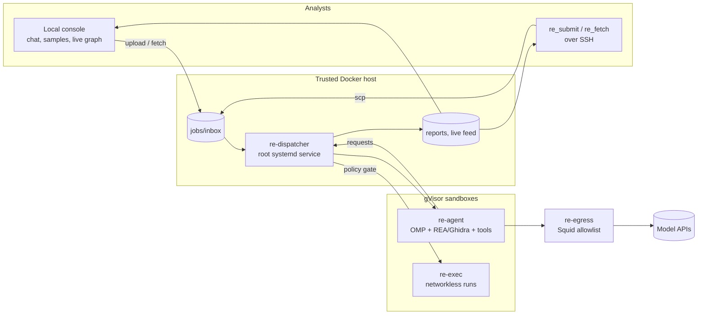

# Skellywix Reverse-Engineering Kit

A container stack for static analysis and controlled dynamic execution of untrusted binaries. A trusted Docker host admits jobs, verifies immutable inputs, launches a fresh analysis agent per job, brokers isolated execution requests under an operator policy, and publishes bounded, redacted reports. A local web console lets analysts submit samples, chat with specialist agents, and watch each job move through the pipeline live.

This project processes hostile input. Read [SECURITY.md](SECURITY.md) and [the design](docs/design.md) before deployment.

## How it works



1. A job (target files, a question, and a SHA-256 manifest) lands in the inbox from the console or `re_submit.py`.
2. The dispatcher claims it into a root-only work directory, copies every file into root-owned trees while hashing exactly the bytes it keeps, and rejects anything that differs from the manifest.
3. One fresh gVisor agent container analyses the job. Its only network path is a Squid proxy that allows CONNECT to five model hosts and refuses everything else before resolving it.
4. When static evidence is not enough, the agent writes a closed-schema execution request. The operator's execution policy allows, blocks, or holds it for approval; allowed requests run in a fresh networkless gVisor container against a private copy of the verified target.
5. The dispatcher publishes a redacted report, evidence, session log and a typed `result.json`, and streams a bounded live event feed that the console renders as a workflow graph.

## Components

| Path | Role |
|---|---|
| `container/re-dispatcher.py` | Trusted host service: claim, copy-and-hash admission, isolation, containment, limits, publication, live feed, and the `--check`, `--init-layout`, `--prune` and `--cleanup-only` operator commands. |
| `container/executor.py` | Closed-schema broker that runs execution requests in fresh networkless containers. |
| `container/execpolicy.py` | Operator execution rules and approval decisions written by the console. |
| `container/livefeed.py` | Bounded, redacted live event feed and session tailer for the console. |
| `container/runner.py` | Single-job agent entry point inside the agent container. |
| `container/console/` | Local web console (chat, samples, live workflow, specialists, model keys). See [docs/console.md](docs/console.md). |
| `container/re_submit.py`, `container/re_fetch.py` | SSH helpers that upload a job and retrieve its report. |
| `container/Dockerfile`, `container/compose.yaml` | Multi-stage `agent`, `exec` and `egress` images, and the long-running egress proxy. |
| `container/egress-allowlist` | Deny-first Squid policy for the named model endpoints. |
| `container/re-dispatcher.service`, `container/re-console.service` | Hardened systemd units. |
| `container/omp-profile/`, `container/prompts/re-job.md` | Self-contained OMP profile (REA is its only MCP server) and the job prompt. |
| `container/exec-request.schema.json` | The execution-request and result contract. |

The images include OMP, REA, Ghidra, JADX, radare2, Binwalk, Unblob, capa, YARA-X, Detect It Easy, WABT, wasm-tools, Binaryen, Wasmtime, TShark, Zeek, Scapy, Frida, and qemu-user in the execution image.

## Requirements

- Linux with systemd and Python 3.12 or newer (`/usr/bin/python3` runs both services).
- Docker Engine 28.0 or newer for the isolated bridge gateway; 29.10 or newer is recommended for the 2026 security fixes. Older engines ignore or reject `gateway_mode_ipv4`, so the dispatcher's preflight refuses to start on them.
- gVisor registered as the `runsc` runtime, release-20260831.0 or newer (CVE-2026-95702, CVE-2026-96812).
- A dedicated, size-bounded filesystem mounted at `/srv/re-lab`.
- Analysts who submit jobs belong to the `relab` group (gid 10001) and must not be in the `docker` group.

## Host setup

### 1. Bounded storage

Create the bounded filesystem on the Docker host before starting the dispatcher. Verify that
`/etc/fstab` has no existing `/srv/re-lab` entry before appending this example:

```bash
install -d -o root -g root -m 0755 /srv/re-lab
truncate -s 40G /var/lib/re-lab.img
mkfs.ext4 -F -N 1000000 /var/lib/re-lab.img
printf '%s\n' '/var/lib/re-lab.img /srv/re-lab ext4 loop,nodev,nosuid,nofail 0 2' >> /etc/fstab
systemctl daemon-reload
mount /srv/re-lab
findmnt --verify
```

The explicit inode count bounds entry floods. `RequiresMountsFor=/srv/re-lab` prevents the
dispatcher from using the bare directory if the mount is absent. The dispatcher also keeps a
storage reserve (1 GiB and 20,000 inodes by default): it stops claiming new jobs below it, and
contains a running job whose agent or sandbox runs push free space under it (`storage-cap`).

The image is a sparse file on the host root filesystem, so written blocks consume host root
space up to 40 GiB. Keep that much space free there, and run `fstrim /srv/re-lab` or the
distribution's `fstrim.timer` after jobs are deleted to return unused blocks.

### 2. Accounts and the directory tree

```bash
groupadd --gid 10001 relab
useradd --system --gid relab --home-dir /var/lib/re-console --shell /usr/sbin/nologin re-console
```

`re-console` is needed only for the console. Put its uid in `dispatcher.json` as `console_uid`
(step 4) before running `--init-layout`, which creates or repairs every directory with exact
owners and modes:

| Path | Owner:group | Mode | Purpose |
|---|---|---|---|
| `/srv/re-lab` | root:root | 0755 | Lab root |
| `jobs/inbox` | root:relab | 2770 | Uploads from analysts and the console |
| `jobs/cancel` | root:relab | 2770 | Cancel markers |
| `jobs/work` | root:root | 0700 | Claimed jobs (root only) |
| `jobs/quarantine` | root:root | 0700 | Inbox entries that could not be claimed |
| `reports` | root:relab | 0750 | Published reports |
| `live` | root:relab | 0750 | Live event feed and dispatcher heartbeat |
| `exec`, `exec/runs` | root:root | 0700 | Private execution scratch |
| `secrets` | root:root | 0700 | `models.env` (root, mode 0600) |
| `console`, `console/approvals` | re-console:relab | 0750 | Console-owned keys, execution policy and approvals |

### 3. Images and the egress proxy

Build all three images, provide an upstream resolver file, and start only the egress proxy:

```bash
docker compose -f container/compose.yaml --profile build-only build re-agent re-exec re-egress
AGENT_IMAGE=$(docker image inspect --format '{{.Id}}' re-lab-agent:local)
EXEC_IMAGE=$(docker image inspect --format '{{.Id}}' re-lab-exec:local)
install -d -m 0700 /etc/re-lab
install -m 0644 /path/to/upstream-resolv.conf /etc/re-lab/egress-resolv.conf
docker compose -f container/compose.yaml up -d re-egress
```

Use a resolver file that lists reachable upstream nameservers, not a host loopback stub.

### 4. The dispatcher

```bash
install -d /opt/re-lab
install -m 0644 container/re-dispatcher.py container/executor.py \
  container/execpolicy.py container/livefeed.py container/re_submit.py /opt/re-lab/
install -m 0644 container/re-dispatcher.service /etc/systemd/system/re-dispatcher.service
printf '{"agent_image":"%s","exec_image":"%s"}\n' "$AGENT_IMAGE" "$EXEC_IMAGE" \
  > /etc/re-lab/dispatcher.json
chmod 0600 /etc/re-lab/dispatcher.json
python3 /opt/re-lab/re-dispatcher.py --config /etc/re-lab/dispatcher.json --init-layout
install -o root -g root -m 0600 /dev/null /srv/re-lab/secrets/models.env
```

With the console, add `"console_uid": <uid of re-console>` to `dispatcher.json` before running
`--init-layout`; without it the dispatcher ignores the console directory entirely.

Put model credentials in `/srv/re-lab/secrets/models.env` as `NAME=value` lines (for example
`OPENROUTER_API_KEY=...`), or enter them in the console's **Models & API keys** page, which
writes `/srv/re-lab/console/models.env`; console values win for the same name. The dispatcher
validates both files and passes the agent a per-job, root-only copy. It drops names that change
how the runtime behaves (`PATH`, `LD_*`, `PYTHON*`, `NODE_OPTIONS`, proxy variables and others).
Never add credentials to an image, Compose file, repository, or CI secret.

`dispatcher.json` accepts only these keys: `root`, `agent_image`, `exec_image` (both
content-addressed), `models_env`, `network` (never a built-in network), `agent_uid`, `agent_gid`
(at least 1000), `report_gid`, `docker_prefix`, `console_uid`, `agent_cpus` (default 4),
`min_free_mib` (default 1024), `min_free_inodes` (default 20000) and `live` (default true).
Published directories are mode `0750` and files `0640`, group `report_gid` (`relab`).

```bash
python3 /opt/re-lab/re-dispatcher.py --config /etc/re-lab/dispatcher.json --check
systemctl daemon-reload
systemctl enable --now re-dispatcher.service
```

`--check` prints PASS/WARN/FAIL lines for the directory tree, `models.env`, the storage reserve,
the Docker version, the `runsc` runtime, both images, the internal network (internal, isolated
gateway, expected subnet), the egress proxy, and the `runsc` release. The unit runs it as
`ExecStartPre=` and refuses to start on any FAIL.

### 5. Verify isolation before accepting untrusted work

- `docker info` lists `runsc`, and `--check` reports no FAIL.
- From an agent container, the egress probe reaches only the five allowlisted hosts; a CONNECT to
  any other name is refused without a DNS lookup.
- Direct connections to the internal bridge gateway fail, for example
  `docker run --rm --runtime=runsc --network re-lab_re-internal re-lab-exec:local bash -c 'exec 3<>/dev/tcp/172.30.97.1/22'`
  must fail, and `ip -4 -o addr show dev br-$(docker network inspect -f '{{.Id}}' re-lab_re-internal | cut -c1-12)`
  prints nothing on the host.
- Execution containers have no network, and the agent sees only the active job's mounts.

### 6. The local console (optional)

The console is an unprivileged service (user `re-console`, group `relab`) bound to
`127.0.0.1:8484`. It never receives the Docker socket and talks to the lab only through files
under `/srv/re-lab`. Reach it locally or through `ssh -L 8484:127.0.0.1:8484 docker-host`.
Installation, authentication, the API, and a no-lab demo mode are in [docs/console.md](docs/console.md).

### Running under gVisor

gVisor cannot use Docker's embedded DNS on this user-defined network. The egress proxy mounts
the operator-supplied upstream resolver file, while each agent receives an `/etc/hosts` entry
for the proxy through `--add-host`. The internal network is fixed at `172.30.97.0/24`, with the
proxy at `172.30.97.2`; if that subnet conflicts with another Docker network, change the
Compose subnet/address, the proxy's `agent_net` ACL, and `EGRESS_IP`/`EGRESS_SUBNET` in
`re-dispatcher.py` together.

The agent home is a `noexec` tmpfs. The image build therefore extracts OMP's native addon and
installs it beside the OMP binary, where the native loader can map it without weakening the
home mount. The egress proxy starts as its unprivileged user with no added capabilities.

### Qualification limits

Qualification covered one runtime host: an egress probe from an agent container reached only
the five allowlisted model and sign-in hosts, a fill of the lab filesystem stopped at its
40 GiB boundary, and two benign smoke jobs—one static and one through the executor—published
reports end to end. That qualification predates this revision: the images now carry security
updates (APT snapshot, Ghidra 12.2, radare2, YARA-X, Wasmtime, Node.js) and the dispatcher's
admission, containment and publication paths changed, so repeat the checks above and both smoke
jobs before accepting untrusted work. Another runtime host needs the same checks, starting with
the resolver file and internal subnet.

## Submitting work

From the console, upload files or give a URL ("Fetch & analyse"), pick a specialist or let
**Auto** route by file type, and follow the job in the live workflow graph. The console host
fetches URLs; the analysis sandbox never has internet access.

From the command line, both helpers require an SSH target, given with `--host` or `RE_LAB_HOST`:

```bash
export RE_LAB_HOST=docker-host
python container/re_submit.py ./target "Explain this binary" \
  --executable bin/tool --executable scripts/run --max-cost 5
python container/re_fetch.py <job-id> --dest ./reports --wait
```

`re_submit.py` stages the target with a SHA-256 manifest, uploads it to a hidden inbox name,
and renames it into place (`mv -T`, so it never merges into an existing job); a failed upload is
removed. `--executable REL` stages a target-relative file as mode `0755`; `--dry-run` prints the
manifest without a host. `re_fetch.py` copies a report only after `result.json` exists (exit 3
otherwise; `--wait` polls), copies through a private temporary directory, and prints only
validated, escaped status fields. Report content is untrusted model output about a hostile file.

## Job statuses

| Status | Set by | Meaning |
|---|---|---|
| `done` | agent | Finished; the report answers the question or bounds the unknowns. |
| `cost-cap` | agent | OMP stopped at the job's cost limit (at most $20). |
| `time-cap` | agent or dispatcher | OMP's 2 h limit, or the dispatcher's 2 h 5 min wall clock. |
| `needs-vm-lane` | agent | Needs Windows dynamic analysis, full-system emulation, or network fuzzing; see `reason`. |
| `failed` | either | See `error`: a runner error code, `agent exit N`, `dispatcher stopped`, a host failure, or `containment failed`. |
| `storage-cap` | dispatcher | Free space or inodes fell below the reserve; the job was contained. |
| `cancelled` | dispatcher | A cancel marker (`jobs/cancel/<id>`) arrived before or during the run. |
| `rejected-job` | dispatcher | Malformed manifest or layout, or an unsafe file name. |
| `rejected-hash` | dispatcher | Content, file set, link, special file, or hard link differs from the manifest. |
| `recovered-after-restart` | dispatcher | Interrupted by a crash or host restart before publication. |

`result.json` is built from dispatcher-owned facts: `job_id`, `status`, `exit_code` (the agent
container's exit code, or null when contained), `model` (from the verified manifest),
`started`/`ended` (dispatcher clock), `cost_usd`, `cost_incomplete`, and `error` or `reason`.
The agent can claim only a status from its allowlist, a VM-lane reason, or a fixed error code.

## Operating the lab

- **Cancel:** create `jobs/cancel/<id>` (the console's Cancel button does this). A queued job is
  cancelled at claim; a running job's agent and sandbox runs are contained within about a second.
- **Stop:** `systemctl stop re-dispatcher` contains the active job, publishes it as `failed`
  (`dispatcher stopped`), and exits; `ExecStopPost` then removes any labeled container, also
  after a crash.
- **Retention:** `re-dispatcher.py --config … --prune 30` deletes the work trees and live feeds
  of jobs that finished more than 30 days ago (`--include-reports` also deletes their reports).
  Unfinished jobs are never selected.
- **Quarantine:** an inbox entry that cannot be claimed (for example a reused job id) is moved to
  `jobs/quarantine/` and logged instead of stopping the queue.
- **Logs:** `journalctl -u re-dispatcher`; the egress proxy logs bounded lines through Docker's
  rotating `local` driver.

More detail, including the exact-value redaction rules and execution policy semantics, is in
[docs/operations.md](docs/operations.md).

## Tests

```bash
python -m pip install --require-hashes --no-deps --only-binary=:all: -r requirements-dev.txt
sudo python3 -m unittest discover -s tests -t .
```

Run the suite as root on Linux to exercise uid, ownership, `openat`, `O_NOFOLLOW`, and symlink
boundaries. Tests that need POSIX descriptor operations or root skip themselves elsewhere.

## CI

CI runs on Ubuntu 24.04 with read-only repository permissions and credential-less checkouts:

1. `unit` runs the full suite as root on Python 3.12, 3.13 and 3.14 with hash-locked test
   dependencies; `host-python` runs it with the distribution `/usr/bin/python3` that the units use.
2. `lint` runs ruff, a zizmor workflow audit, Hadolint from a digest-pinned image, the Compose
   model check, `systemd-analyze verify` for both units, and byte-compilation.
3. `image` runs after both pass. A matrix builds the `agent`, `exec`, and `egress` targets with
   isolated GitHub Actions caches and parses the Squid configuration inside the egress image.
   A weekly scheduled run rebuilds without cache, so every pinned download and checksum is
   fetched and verified again.

The image job proves that every pinned URL, SHA-256 check, build stage, and `COPY` path resolves
(on cached runs, only for the stages that rebuilt). It does not prove gVisor runtime behavior or
the end-to-end job lifecycle on a configured Docker host.

## Supply-chain pins

The base images are digest-pinned, apt uses the dated Ubuntu snapshot `20261118T000000Z`, Python
packages are hash-locked in `container/requirements.lock`, and every downloaded artifact is
verified before extraction. Exact public URLs and SHA-256 values are in `container/Dockerfile`.
Two documented exceptions are verified by distribution keyrings rather than a date: the one-time
`ca-certificates` bootstrap before the switch to the snapshot, and two build dependencies of the
build-only binwalk stage.

| Artifact | Version | SHA-256 |
|---|---|---|
| Ubuntu image index | 24.04 | `73b999393d07f2bf65a40373778a44dc9a6d54ad7718d29247d8ff9413c4d6a8` |
| Rust image index | 1.100.0-bookworm | `ade39a710ef85f3506cffcfec3e8a24ba090badef1dff2fb798f71d878833fea` |
| OMP | 18.22.0 | `f706b27ba845834d8f8360705a2e9ba1534f3593fa24411d41358272de33642b` |
| Node.js | 22.23.5 | `cdeb8670a0c81f51b4dc4ac61919f9b1ad917b304bf8221eb939570663d240f8` |
| REA | 6.8.0 | `8d542ec76a9cb350584b60a6c9c088706ff812d5bb5b094c20c95b6dc25698bb` |
| REA lockfile | commit `160d821ac9a0310afcb8d1fc427862dd6508add5` | `1d8fa0f33b3125d3e601ec832b18d9d35b37453f36340dc0507f065a8de158ad` |
| Temurin JDK | 25.0.5+8 | `68982529869257d0ee6b824ec5aa270ff8b118bb438670da0b97ebdab178d7fb` |
| Ghidra | 12.2 | `2c2cd776db3c1f6a097ba418922378ac3649cadd5e844a6f5f088ae628a7be67` |
| JADX | 1.5.6 | `545ea2be9c242511bc145755cf4bda2485ade42966e096f8b4d3da2a230e8974` |
| Zeek | 9.0.1 | `fbee2eb5ee6ebd64ef0db830fbb9fa1d702d58807643c719e8338a59329197f2` |
| radare2 | 6.2.6 | `0dddf90e217e38a6a658881b9ec7e217198487c75b7f82a332b3cbd30834636f` |
| Binwalk | 3.1.0 | `99d5dc70f5021c55624f098adae4d1de9c1c07d000475664704b675aad7e0811` |
| capa | 10.0.0 | `96cb5115f495024a478b0e9f9f77f9027058155589235fbd4c50e7382055fcca` |
| YARA-X | 1.23.0 | `da0c17f23fc743dcd44ad6d3135c906a4c0d197685b661c4cdc923c2f8967a64` |
| Detect It Easy | 3.21 | `96e8e82e822e3ca8a829536312b92e8b241147fe38c8ab29c9dbfc1ab21aa25d` |
| WABT | 1.0.42 | `84895407a6bbb80e918f33b16b2fb2206021c150b6bc9ff6f761263a745ab131` |
| wasm-tools | 1.262.0 | `655b8df67d54c3ef9b52fc237c4e94bbfbb5f5f43825245cb0940a7002a9ed65` |
| Binaryen | 133 | `2dc9c7813f5375db93d96ead4b78222fcc3e2677bbb832297af4797782a37489` |
| Wasmtime | 50.0.2 | `5db0ca8e838ab95a51ba9acdf11f42888bcd0092dda45a86129ae540c4fa952c` |

REA 6.8.0 was verified against Ghidra 12.1.4; with Ghidra 12.2 (which fixes the October 2026
parser advisories) REA reports an unverified-build limitation in its sessions. Ubuntu's
`tshark` and `p7zip-full` builds carry known parser bugs that the snapshot cannot fix; they run
only inside the gVisor sandboxes.

## Accepted risks

- **Key exposure — accepted risk.** Model keys exist inside each per-job agent container.
- **Cost-cap bypass — accepted risk.** The native `$20` maximum is effective only while the
  agent is uncompromised, and it is soft by one request.
- **Report disclosure — accepted risk.** Exact-value redaction (also of hex and base64 forms) is
  not robust against split, transformed, encrypted, or indirect secret disclosure in report output.
- **Isolation escape — accepted risk.** gVisor reduces kernel attack surface but is not a
  virtual-machine boundary.
- **Allowed-endpoint exfiltration — accepted risk.** Allowed model endpoints can carry target
  data.
- **Prompt-enforced boundary — accepted risk.** "The agent never executes the target" is a prompt
  rule; the agent image contains interpreters, so a confused or compromised agent can run target
  code next to its keys, inside gVisor.

See [SECURITY.md](SECURITY.md) for the full threat model and vulnerability reporting process.
